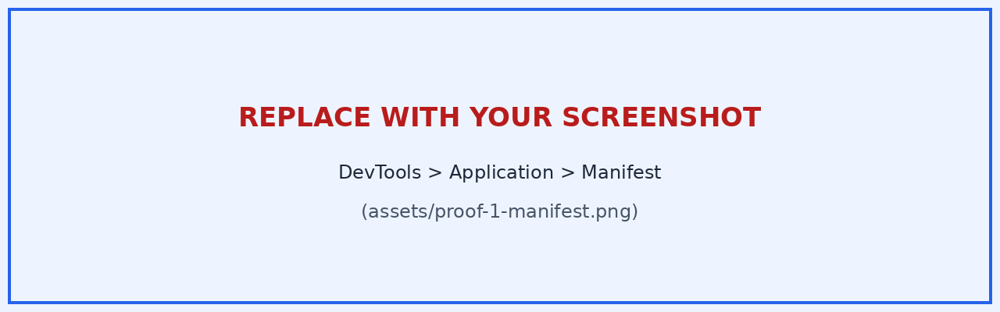
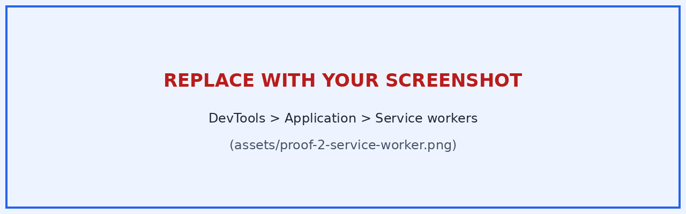
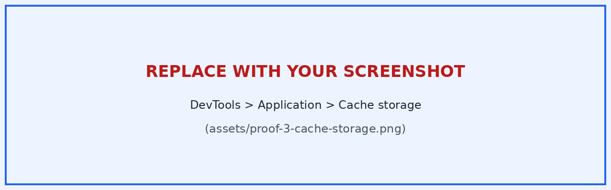
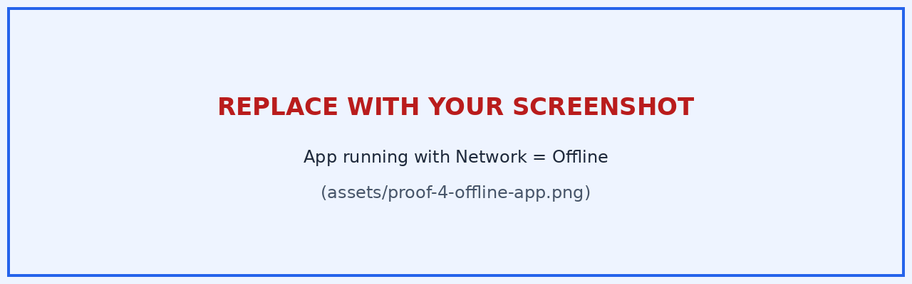
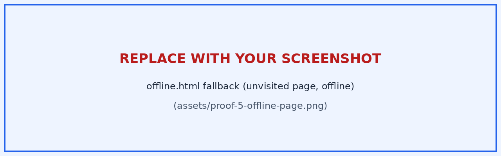
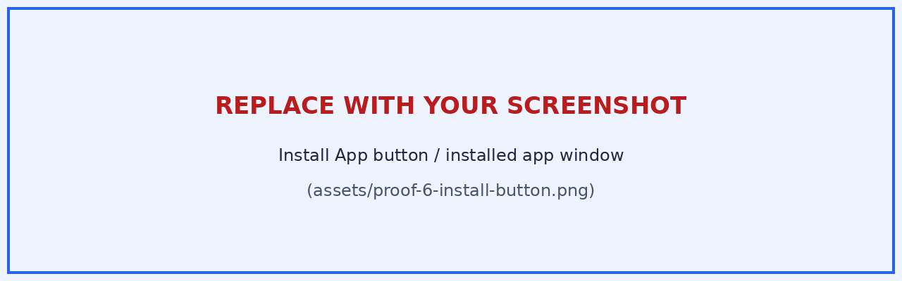

<h1 align="center"> Todo App </h1>

<table align="center">
  <tr>
    <th style="text-align: center;">NRP</th>
    <th style="text-align: center;">Nama</th>
    <th style="texxt-align: center;">Kelas</th>
  </tr>
  <tr>
    <td style="text-align: center;">5025251043</td>
    <td style="text-align: center;">Tri Zuyyina Rohmah</td>
    <td style="text-align: center;"> PWEB A</td>
  </tr>
</table>

# Preview Todo-App

---

# E05 - The Offline Abyss (Progressive Web App)

The Todo App is now an installable PWA that keeps working with no network.

## What was added

| File | Purpose |
|------|---------|
| `manifest.json` | Web app manifest: name, `start_url`, `scope`, `display: standalone`, theme colours, icons (192, 512, maskable 512) and shortcuts for Personal / Shared |
| `icons/` | App icons (`icon-192.png`, `icon-512.png`, `icon-maskable-512.png`, `apple-touch-icon.png`, `favicon-32.png`) |
| `sw.js` | Service Worker: precache + per-resource caching strategies |
| `offline.html` | Fallback page shown when a page that was never cached is opened offline |
| `index.php` | Links the manifest, icons, `theme-color`, adds the Install button and offline banner |
| `script.js` | Registers the SW, handles `beforeinstallprompt` / `appinstalled`, shows an online/offline banner |
| `style.css` | Styles for the install button and offline banner (light + dark mode) |

## 1. Web app manifest

`manifest.json` is linked from `index.php` with `<link rel="manifest" href="manifest.json">`.
It declares `name`, `short_name`, `start_url` (`./index.php?page=personal`), `scope` (`./`),
`display: standalone`, `theme_color`, `background_color` and three icons, one of them with `purpose: "maskable"`.

## 2. Precache (app shell + offline page)

On `install`, `sw.js` precaches:

- `index.php?page=personal` and `index.php?page=shared` (the app shell for both tabs)
- `offline.html`
- `style.css`, `script.js`, `manifest.json`
- all icons

Old caches are deleted on `activate` (cache names are versioned, bump `VERSION` in `sw.js` after changing shell files).

## 3. Caching strategy per resource

| Resource | Strategy | Why |
|----------|----------|-----|
| Page navigations (`index.php`, `/`) | **Network-first** (4 s timeout) -> cached shell -> `offline.html` | Always fresh when online, still opens offline |
| `style.css`, `script.js`, manifest, icons | **Stale-while-revalidate** | Instant load, silently updated in the background |
| `api.php?action=list` (todo data) | **Network-first** -> last cached list | Online users see live data, offline users see the last known list |
| `uploads/*` (todo images) | **Cache-first** (max 60 images) | File names are unique, content never changes |
| `POST` requests (`save`, `delete`) and anything cross-origin | **Not intercepted** | Writes must always reach the server |

Workbox was not used, the Service Worker is written in plain JavaScript so the project has no build step or CDN dependency.

## 4. Install button

`#install-button` in the header is hidden by default. When the browser fires `beforeinstallprompt`
the event is stored and the button is shown; clicking it calls `prompt()`. The button is hidden again after the
prompt is answered or on `appinstalled`.
(Chrome / Edge / Android only. Safari on iOS has no install event, use *Share > Add to Home Screen*.)

## 5. Testing offline (proof)

PWAs need a secure origin: use `http://localhost/...` (XAMPP/Laragon) or HTTPS.

1. Open the app once while online (e.g. `http://localhost/5025251043_Todo-App/index.php?page=personal`), also open the **Shared** tab once.
2. **DevTools > Application > Manifest**: no errors, icons shown, "Installable".
3. **Application > Service workers**: `sw.js` is *activated and running*.
4. **Application > Cache storage**: `todo-shell-v3` (precache), `todo-data-v3` (todo lists) are present.
5. Tick **Application > Service workers > Offline** (or **Network > Offline**) and reload: the app, the todo list and the Shared tab still load, and the yellow "Kamu sedang offline" banner appears.
6. Open a never-visited URL such as `.../not-cached.html` while offline: `offline.html` is shown.
7. Click **Install App** in the header (or the install icon in the address bar) and open the installed app with the network off.

### Screenshots

> The images below are placeholders. Replace each file in `assets/` with your own DevTools screenshot (same file name).

**Manifest**

**Service worker activated**

**Cache storage**

**App working offline**

**Offline fallback page**

**Install button / installed app**

## Known limitations

- Todos are stored in MySQL through `api.php`. Offline you can **read** the last loaded list, but adding / editing / deleting needs a connection (writes are not queued).
- The offline list is only as fresh as the last time the page was loaded online.
