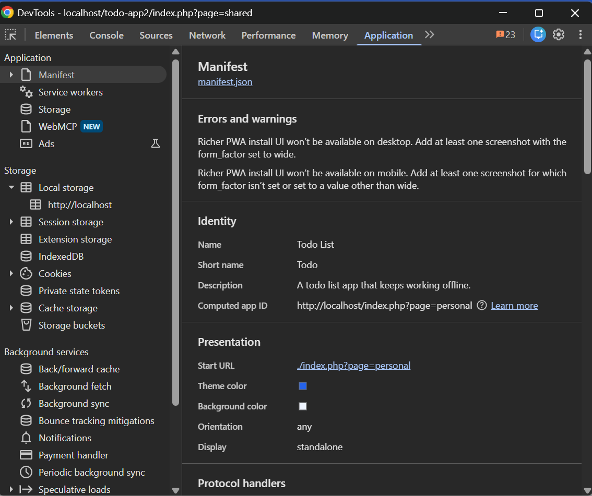
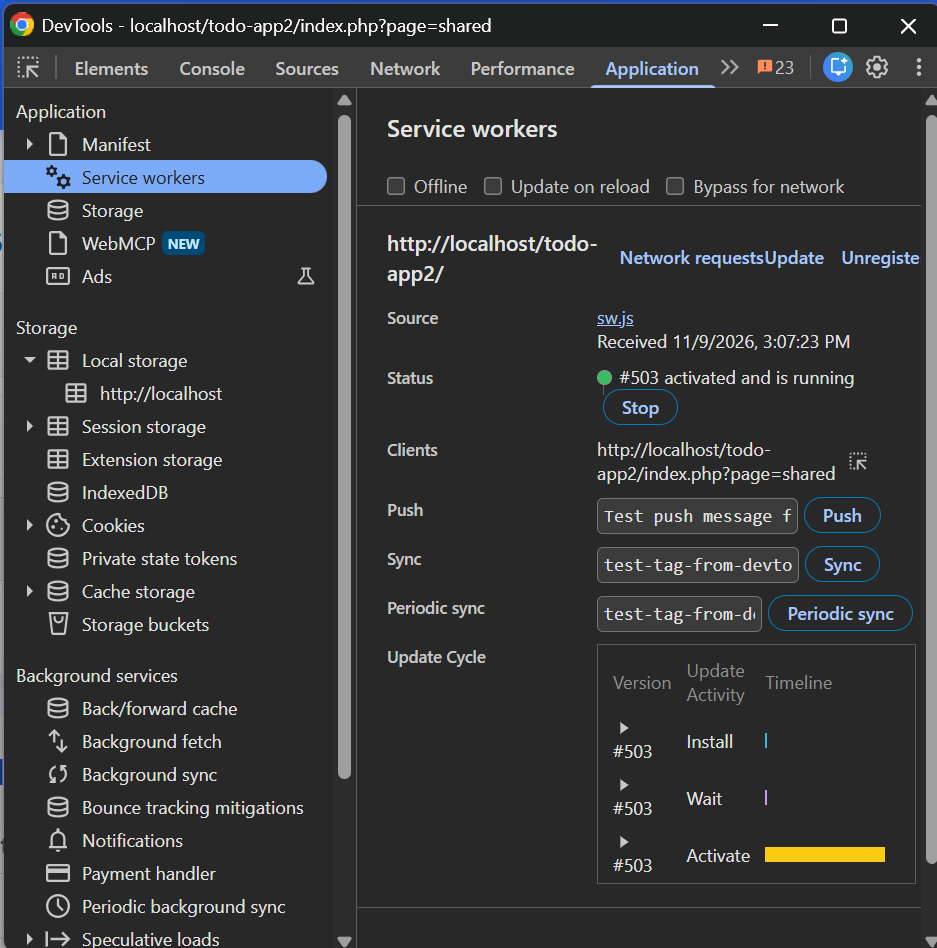
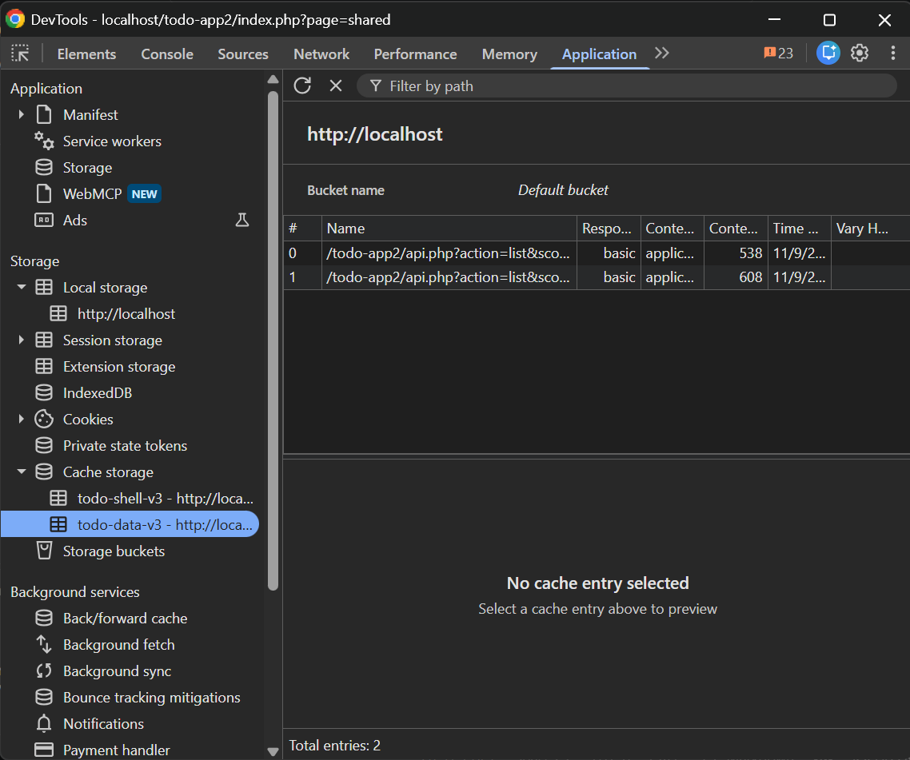
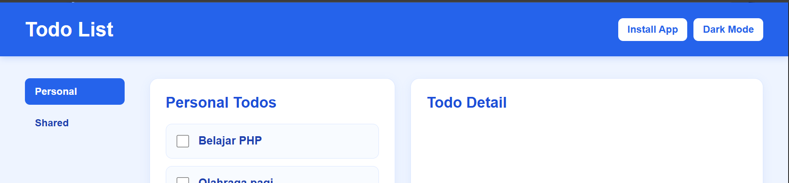
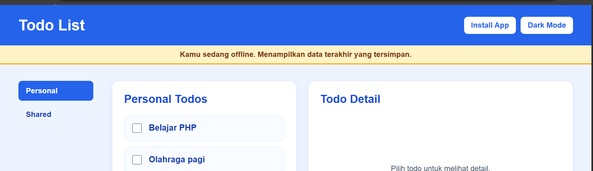
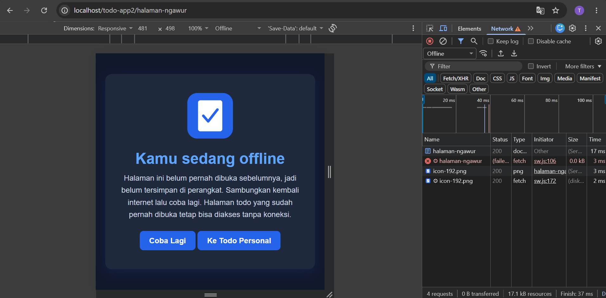
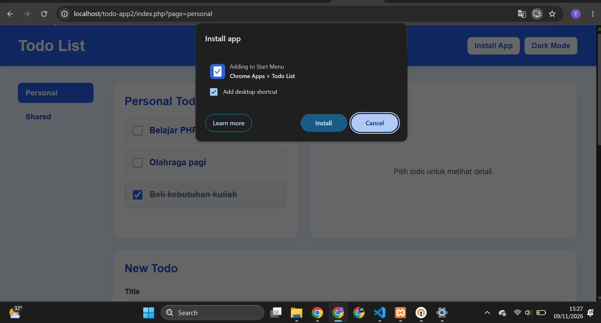
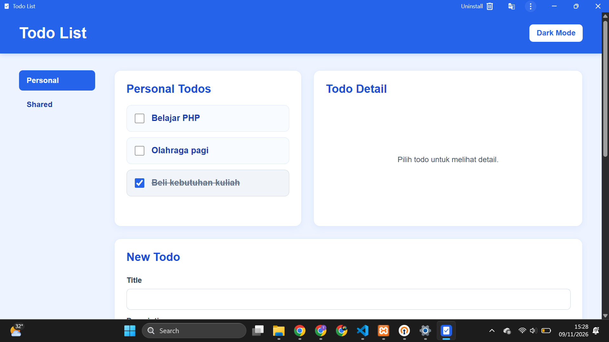

<h1 align="center"> Todo App </h1>

<table align="center">
  <tr>
    <th style="text-align: center;">NRP</th>
    <th style="text-align: center;">Nama</th>
    <th style="texxt-align: center;">Kelas</th>
  </tr>
  <tr>
    <td style="text-align: center;">5025251043</td>
    <td style="text-align: center;">Tri Zuyyina Rohmah</td>
    <td style="text-align: center;"> PWEB A</td>
  </tr>
</table>

# [E05] The Offline Abyss - Progressive Web App

Todo App ini sudah di-upgrade menjadi PWA: bisa di-install seperti aplikasi dan tetap bisa dibuka saat offline.

## Ringkasan Implementasi

| No | Tugas | File | Keterangan |
|----|-------|------|------------|
| 1 | Web app manifest + icons | `manifest.json`, `icons/` | `display: standalone`, theme color, icon 192, 512, dan maskable 512. Di-link di `index.php` lewat `<link rel="manifest">` |
| 2 | Precache app shell + offline page | `sw.js`, `offline.html` | Saat event `install`, halaman personal/shared, CSS, JS, manifest, icons, dan `offline.html` disimpan ke cache `todo-shell-v3` |
| 3 | Strategi caching per resource | `sw.js` | Lihat tabel di bawah |
| 4 | Tombol install | `index.php`, `script.js` | Event `beforeinstallprompt` ditangkap, tombol **Install App** muncul, lalu memanggil `prompt()` saat diklik |
| 5 | Testing offline | README ini | Lihat bagian Bukti Pengujian |

## Strategi Caching

| Resource | Strategi | Alasan |
|----------|----------|--------|
| Navigasi halaman (`index.php?page=...`) | Network-first, fallback ke shell di cache, lalu `offline.html` | Konten selalu terbaru saat online, tetap terbuka saat offline |
| CSS, JS, manifest, icons | Stale-while-revalidate | Cepat dari cache, diperbarui di belakang layar |
| `api.php?action=list` | Network-first (timeout 4 detik), fallback ke daftar terakhir di cache `todo-data-v3` | Data todo terakhir tetap tampil saat offline |
| Gambar `uploads/` | Cache-first | Nama file unik dan tidak pernah berubah |
| Request POST (save/delete) | Tidak di-cache, langsung ke network | Operasi tulis harus sampai ke server |

Cache lama dihapus otomatis pada event `activate` berdasarkan `VERSION` di `sw.js`.

## Bukti Pengujian

### 1. Manifest terbaca
Tidak ada error, icon tampil, dan bagian Installability tidak menunjukkan masalah.

### 2. Service Worker aktif
Status `activated and is running`.

### 3. Isi Cache Storage (DevTools > Application > Cache storage)
Terdapat `todo-shell-v3` (app shell + `offline.html`) dan `todo-data-v3` (daftar todo terakhir).

### 4. Tombol Install App

### 5. Berjalan saat jaringan dimatikan (Network > Offline)
Halaman todo tetap terbuka, banner offline muncul, dan data terakhir tetap tampil.

### 6. Halaman fallback offline
Membuka halaman yang belum pernah di-cache saat offline menampilkan `offline.html`.

### 7. Aplikasi ter-install (mode standalone)

## Catatan
- Saat offline, todo yang sudah pernah dimuat tetap bisa dibaca. Menambah, mengubah, dan menghapus todo butuh koneksi karena data disimpan di server (PHP + MySQL).