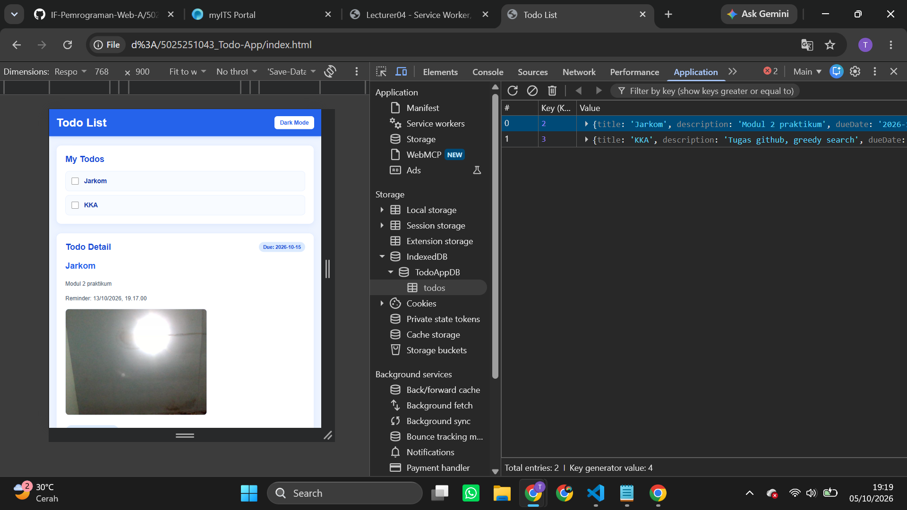

<h1 align="center"> Todo App </h1>

<table align="center">
  <tr>
    <th style="text-align: center;">NRP</th>
    <th style="text-align: center;">Nama</th>
  </tr>
  <tr>
    <td style="text-align: center;">5025251043</td>
    <td style="text-align: center;">Tri Zuyyina Rohmah</td>
  </tr>
</table>

## 1. Web Storage

### IndexedDB

Data todo disimpan di IndexedDB pada database `TodoAppDB` dengan object store `todos`. Setiap todo menyimpan judul, deskripsi, tanggal jatuh tempo, waktu notifikasi, status notifikasi, gambar, dan status selesai.

Penyimpanan diperbarui setiap kali pengguna menambah todo, mencentang todo, menyimpan hasil edit, atau menghapus todo. Saat aplikasi dibuka, data dimuat kembali dari IndexedDB sehingga todo tidak hilang setelah halaman di-refresh. Pada pembukaan pertama, daftar todo kosong sampai pengguna menambahkan todo sendiri.

### localStorage

Preferensi tampilan (light/dark mode) disimpan di localStorage dengan key `theme`. Nilainya berubah antara `light` dan `dark` setiap kali tombol toggle ditekan, dan tema terakhir diterapkan otomatis saat aplikasi dibuka kembali.

Video berikut menunjukkan tampilan berganti sesuai toggle dan nilai localStorage yang ikut berubah: [Perubahan data pada local storage](assets/light_dark.mp4)

---

## 2. Media Capture API

Form todo memiliki field **Image** yang dapat diisi dengan dua cara: mengunggah file gambar, atau mengambil foto langsung menggunakan kamera lewat Media Capture API.

Untuk memakai kamera, pengguna menekan tombol **Use Camera** dan memberikan izin akses kamera. Aliran video tampil sebagai pratinjau, lalu tombol **Take Photo** mengambil satu frame sebagai foto. Setelah foto diambil, kamera dimatikan dan hasilnya tampil sebagai pratinjau gambar pada form. Jika kamera tidak didukung atau izin ditolak, aplikasi menampilkan pesan error dan pengguna masih bisa mengunggah file.

Gambar yang dipilih disimpan bersama todo di IndexedDB dan ditampilkan pada panel **Todo Detail** saat todo dipilih, dengan teks alternatif yang menyebut judul todo.

**Pengujian kamera:** video berikut menunjukkan proses membuka kamera dan mengambil foto: [Menggunakan kamera](assets/camera.mp4)

**Menambahkan gambar ke todo:** video berikut menunjukkan gambar ditambahkan pada form, disimpan, lalu tampil pada detail todo: [Menambahkan gambar](assets/addImage.mp4)

---

## 3. Service Worker dan Notifikasi Todo

Form todo (dan form edit) memiliki field **Notification Time** untuk menentukan kapan pengingat todo muncul.

Aplikasi mendaftarkan Service Worker (`sw.js`) yang menyimpan file utama aplikasi ke cache sehingga aplikasi tetap dapat dibuka saat offline, membersihkan cache versi lama, serta menangani klik pada notifikasi dengan membuka atau memfokuskan kembali jendela aplikasi.

Alur notifikasi:

1. Izin notifikasi diminta saat pengguna menyimpan todo yang memiliki waktu notifikasi.
2. Aplikasi memeriksa jadwal todo saat dibuka dan setiap 30 detik.
3. Jika waktu notifikasi sudah tercapai dan todo belum selesai, notifikasi "Todo Reminder" yang berisi judul todo ditampilkan melalui Service Worker.
4. Todo ditandai sudah dinotifikasi agar pengingat tidak muncul berulang.

Keterbatasan: notifikasi hanya muncul selama browser atau tab aplikasi masih terbuka. Notifikasi yang tetap muncul saat browser tertutup memerlukan Push API dan server.

Pengujian notifikasi dapat dilihat pada video: [Penguji notifikasi](assets/addImage.mp4)

---

## 4. Best Practices Accessibility

| Praktik | Implementasi |
|---|---|
| Struktur semantik | Landmark `header`, `main`, `section`, dan `footer`; heading berurutan; section diberi `aria-labelledby` |
| Navigasi keyboard | Seluruh fungsi dapat digunakan tanpa mouse dengan urutan tab yang mengikuti urutan visual |
| Indikator fokus | Outline tebal 3px yang kontras pada elemen yang sedang difokus |
| Kontras warna | Warna teks todo selesai dan teks kosong diperbaiki agar memenuhi rasio kontras 4.5:1 pada mode terang dan gelap |
| Tidak mengandalkan warna saja | Todo selesai ditandai dengan teks dicoret dan label status, bukan hanya perubahan warna |
| Preferensi gerak | Transisi dan animasi dimatikan untuk pengguna yang memilih `prefers-reduced-motion` |
| Responsif | Tata letak berubah menjadi satu kolom pada layar kecil |
| Penanganan error | Pesan error spesifik dan dekat dengan field, menggantikan dialog `alert()` |
| Keamanan input | Input pengguna di-escape sebelum ditampilkan untuk mencegah XSS |
| Skip link | Pengguna keyboard dapat melompati header langsung ke konten utama |
| Teks alternatif | Semua gambar bermakna memiliki `alt` |